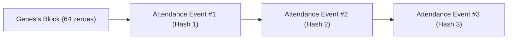

# AERIS — Security Foundation & Cryptography Architecture (Phase 1)

**AERIS (Automated Educational Resource & Institutional Security)** establishes an enterprise-grade cryptographic security foundation designed to guarantee biometric privacy, replay resistance, and tamper-proof audit trails.

---

## 1. Cryptographic Primitives & Standards

| Security Domain | Cryptographic Primitive | Implementation Details |
| :--- | :--- | :--- |
| **Password Storage** | `bcrypt` (Salt Rounds = 12) | Constant-time password verification via `bcrypt.checkpw`, 72-byte max truncation protection, high work factor resistant to offline dictionary attacks. |
| **Token Authentication** | `JWT` (`HS256` / 256-bit HMAC) | Strictly bound claims: `sub` (User UUID), `role`, `emp_id`, `iss="aeris"`, `aud="aeris-app"`, `jti` (unique token UUID), `iat`, `nbf`, and `exp`. Token signature tampering is rejected. |
| **Biometric Encryption** | `MultiFernet` (AES-128-CBC + HMAC-SHA256) | 512-dimensional float32 face embeddings are serialized and encrypted at rest. Supports seamless zero-downtime key rotation via MultiFernet fallback keys. |
| **Audit & Event Integrity** | `SHA-256` Cryptographic Hash Chain | Every attendance check-in is cryptographically chained to its preceding event: `H_n = SHA256(H_{n-1} \| ID \| User \| Campus \| Day \| Timestamp \| Risk \| Device)`. |
| **Transport & Headers** | TLS 1.3 / HSTS / Permissions Policy | `Strict-Transport-Security` (2-year preload), `X-Content-Type-Options: nosniff`, `X-Frame-Options: DENY`, `Permissions-Policy: camera=(self), geolocation=(self)`. |

---

## 2. Key Management & Zero-Downtime Secret Rotation Policy

### A. Environment Configuration (`.env`)
Secrets are decoupled from source code and managed via `.env`:
```bash
# Cryptographic Keys
SECRET_KEY="<256-bit-secure-jwt-secret>"
FERNET_KEY="<32-byte-base64-urlsafe-primary-key>"
FERNET_KEYS_FALLBACK="<optional-previous-key-1>,<optional-previous-key-2>"

# Strict Production Enforcement
ENVIRONMENT="production" # If default dev keys are detected in production, server aborts startup!
```

### B. Standard Operating Procedure (SOP) for Biometric Key Rotation
To rotate biometric encryption keys without service interruption or database downtime:

1. **Generate New Cryptographic Keys**:
   ```powershell
   python scripts/generate_keys.py
   ```
2. **Phase 1 (Zero-Downtime Decryption Fallback)**:
   - In `.env`, set `FERNET_KEY="<new_key>"`
   - Add the previous key to `FERNET_KEYS_FALLBACK="<old_key>"`
   - `MultiFernet` will now encrypt all new biometric enrollments with `<new_key>` while still seamlessly decrypting historical embeddings with `<old_key>`.
3. **Phase 2 (Batch Embedding Migration)**:
   - Run the migration utility with verification dry-run:
     ```powershell
     python scripts/migrate_embeddings.py --old-key "<old_key>" --new-key "<new_key>" --dry-run
     ```
   - Execute the live migration:
     ```powershell
     python scripts/migrate_embeddings.py --old-key "<old_key>" --new-key "<new_key>"
     ```
4. **Phase 3 (Retire Old Key)**:
   - Clear `FERNET_KEYS_FALLBACK=""` in `.env`.
   - The migration is 100% complete and verified.

---

## 3. Cryptographic Audit Chain & Tamper-Proof Verification

Every attendance event is signed and chained:


### Automated Verification Endpoint
Administrators can cryptographically audit the entire institutional attendance ledger:
- **Endpoint**: `GET /admin/audit/verify-integrity`
- **Headers**: `Authorization: Bearer <admin_token>`
- **Response**:
  ```json
  {
    "chain_valid": true,
    "total_records": 128,
    "genesis_hash": "0000000000000000000000000000000000000000000000000000000000000000",
    "latest_hash": "fce80528bd497e4409078376390ae12d5ccbd7063defa8d118c9e5ce58c1f49a",
    "tampered_records": [],
    "verified_at": "2026-10-14T11:56:32.465378"
  }
  ```
- If an attacker or malicious DB admin directly mutates a past timestamp, user ID, or risk score, `chain_valid` immediately drops to `false` and identifies the exact tampered record ID and discrepancy (`PAYLOAD_TAMPERED` or `BROKEN_CHAIN_LINK`).

---

## 4. Rate Limiting & Denial-of-Service Defense
All sensitive endpoints are throttled via `slowapi` keyed on client remote IP:
- `/auth/login` & `/auth/register`: `10 per minute` (Mitigates brute-force credential stuffing)
- `/attendance/verify`: `5 per minute` (Prevents automated replay bursts)
- `/biometric/enroll`: `5 per minute` (Protects server from compute-heavy ArcFace model inference flooding)

---

## 5. Verification Test Suite
Automated regression tests run via:
```powershell
python test_security_suite.py
```
Outputs:
- Bcrypt 12 rounds verification: **PASS**
- JWT claims & signature tampering: **PASS**
- MultiFernet encryption & rotation: **PASS**
- Hash chain integrity & tamper detection: **PASS**
- Security headers & permission policy: **PASS**

---

## 6. Phase 3: Gate Access Cryptography, Dynamic QR & Offline Synchronization

### A. 12-Second Dynamic Rotating QR Protocol
1. **Windowed HMAC-SHA256 Token Structure**:
   ```
   Payload = user_id | role | time_window | nonce
   Signature = HMAC-SHA256(SECRET_KEY, Payload)[0:24]
   EncodedToken = Base64UrlSafe(Payload | Signature)
   ```
   - `time_window = floor(current_unix_time / 12)`
   - `drift_tolerance = +/- 1 window` (allows slight turnstile optical reader clock skew)
2. **Replay Attack Elimination via Ephemeral Nonces**:
   - Each dynamic QR token contains a single-use 12-character cryptographic nonce.
   - Upon turnstile presentation, the server verifies the HMAC signature first, checks that `time_window` is within the active 12-second window, and checks that `nonce` has never been consumed.
   - Nonces are consumed atomically upon first entry. Any subsequent presentation of the exact same token (e.g. from a smartphone screenshot or video replay) is rejected with `QR_TOKEN_ALREADY_USED`.

### B. Hardware Turnstile & Scanner Authorization
- Only pre-registered gate devices (`GateDevice`) with status `authorized` can submit verify scans or sync events.
- Devices in `maintenance` or `revoked` state are rejected with HTTP 403 `DEVICE_UNAUTHORIZED`.
- Periodic device heartbeats update `last_heartbeat` to monitor network health.

### C. Offline Storage & Idempotent Synchronization
- When local campus fiber or wireless connectivity drops, turnstiles buffer scans in a local SQLite store.
- Each event is tagged with a client-generated UUID `client_event_id` and `offline_device_timestamp`.
- Upon network restoration, `/gate/sync-offline` batch-transfers records.
- Deduplication is guaranteed: duplicate transmissions (e.g. network timeouts causing client retries) are skipped via `client_event_id` index lookup without throwing errors.
- Synced records are sequentially chained into the server's cryptographic SHA-256 ledger.

### D. Cryptographic Ledger Hash Verification
- **Endpoint**: `GET /gate/audit/verify-integrity`
- Validates that each gate event is chained:
  $$H_n = \text{SHA256}(H_{n-1} \parallel \text{id} \parallel \text{user\_id} \parallel \text{gate\_id} \parallel \text{direction} \parallel \text{event\_type} \parallel \text{device\_id} \parallel \text{timestamp} \parallel \text{synced\_offline})$$
- Detects unauthorized database insertions, deletions, or backdated events.

---

## 5. Phase 7: Privacy, Image Security, Access Logging & Retention Architecture

### A. Raw Image Non-Persistence Principle
- **Default Non-Persistent Processing**: Raw facial images received from camera devices during enrollment or double-verification check-ins are processed **strictly in volatile memory (RAM)**.
- **Immediate Memory Scrubbing**: After facial embedding extraction (512-dimensional vector) and liveness evaluation, raw image buffers and numpy ndarrays are scrubbed in RAM using `scrub_image_memory()` and dereferenced.
- **Audit Verification**: Every profile and access log strictly maintains `raw_image_persisted = False`. Writing raw facial image frames to disk, object stores, or secondary persistence is architecturally prohibited.

### B. Purpose-Limited Biometric Storage
- **Cryptographic Encryption at Rest**: Extracted embeddings are serialized and encrypted using AES-256 (Fernet / MultiFernet with key rotation).
- **Mandatory Purpose Limitation Tag**: Each stored template is bound to `purpose_limitation = "CAMPUS_IDENTITY_AND_ATTENDANCE_ONLY"` and classified as `RESTRICTED_SPECIAL_CATEGORY_PVI`.
- **Purpose Enforcement**: Accessing or querying biometric templates outside the authorized academic identity and attendance domain is rejected with HTTP 403 `PURPOSE_VIOLATION`.

### C. Biometric Access Logging
- Every template access (write, match, decrypt, revoke, or erase) is audited in the immutable `BiometricAccessLog` table:
  - `accessor_id` & `target_user_id`
  - `purpose` (enforced)
  - `action` (`DECRYPT_AND_MATCH`, `WRITE_TEMPLATE`, `REVOKE_CONSENT`, `CRYPTOGRAPHIC_ERASURE`)
  - `status` (`AUTHORIZED_SUCCESS`, `DENIED_UNAUTHORIZED`, `REVOKED_BLOCKED`)
  - `client_ip` & `user_agent`
  - `raw_image_persisted = False`

### D. Consent, Revocation & Erasure Workflows (DPDP & GDPR)
1. **Consent Revocation (`POST /privacy/consent/revoke`)**:
   - Immediate revocation of biometric check-in privileges.
   - Cryptographically zeroes out the sensitive face vector (`encrypted_embedding = b""`).
   - Flags profile as `CONSENT_REVOKED` and switches the member to physical RFID card / authorized PIN fallback.
2. **Right to be Forgotten (`POST /privacy/delete-biometric-data`)**:
   - Completely and permanently removes the `BiometricProfile` row from the database (GDPR Article 17 / DPDP Section 12).
   - Generates a tamper-evident SHA-256 deletion confirmation receipt hash:
     $$\text{Receipt} = \text{SHA256}(\text{user\_id} \parallel \text{employee\_id} \parallel \text{timestamp} \parallel \text{"CRYPTOGRAPHIC\_ERASURE\_CONFIRMED"})$$

### E. 90-Day Operational Retention Policy & Cleanup
- **Storage Limitation Principle**: High-volume ephemeral operational telemetry (yaw deltas, GPS coordinates, failed verification attempts) and completed notification delivery records are retained for a maximum of 90 days.
- **Automated Scheduled Cleanup (`POST /privacy/retention/run-cleanup`)**:
  - Purges `VerificationAttempt` records where `created_at < now - 90 days`.
  - Purges delivered `Notification` records where `created_at < now - 90 days`.
  - Purges `BiometricAccessLog` records older than 90 days.
  - Generates a signed, verifiable **Retention Compliance Certificate** (`compliance_cert_hash`).
  - Summary academic attendance ledgers and cryptographic hash chains remain permanently preserved.

### F. Encrypted Backup Lifecycle & Automated Disaster Recovery Test Drill
1. **Encrypted Snapshot Creation (`POST /privacy/backups/create`)**:
   - Takes a point-in-time SQLite snapshot.
   - Encrypts using primary Fernet AES-256 key into `backups/aeris_backup_<timestamp>.enc`.
   - Computes SHA-256 checksum and sets a 30-day expiration window (`expires_at = now + 30 days`).
2. **Expired Backup Pruning (`POST /privacy/backups/cleanup-expired`)**:
   - Automatically unlinks and removes backup files past their 30-day lifecycle.
3. **Automated Recovery Test Drill (`POST /privacy/backups/test-recovery`)**:
   - Restores encrypted snapshot into an isolated scratch database.
   - Runs SQLite `PRAGMA integrity_check;` (guarantees zero corruption).
   - Audits row counts across core tables (`users`, `attendance`, `gate_events`).
   - Cleans up scratch restoration file and records recovery test duration and certification status.

---

## 8. Phase 8: Multi-Dimensional Monitoring, Consolidated Audit & Merkle Blockchain Anchoring

### 8.1 Multi-Dimensional Filtering & Monitoring Reports Engine
AERIS Phase 8 introduces cross-cutting operational visibility with spatial and role-based filtering:
- **Filtering Dimensions**: Department (`CSE`, `ECE`, `ME`, `CIVIL`, etc.), Spatial Hierarchy (Building, Floor, Room), Role (`student`, `faculty`, `staff`, `guard`, `worker`, `visitor`), and Temporal Windows (`date_from`, `date_to`).
- **Reports**:
  1. `Attendance Reports`: Verification method, room presence match, geofence face scores, risk scores, and event hash.
  2. `Gate Turnstile Reports`: Dynamic QR entries, guard overrides, visitor passes, offline batch sync indicator, direction, and event hash.
  3. `Staff Duty & Shift Reports`: Scheduled shifts, time windows, assigned locations, and active check-in duty compliance status.
  4. `Verification Attempts Reports`: Full acceptance and failure code logs (`OUTSIDE_CAMPUS`, `FACE_MISMATCH`, `NO_FACE_DETECTED`), distance, and device ID.
- **Export**: Full CSV and JSON export support for regulatory compliance and audit archiving.

### 8.2 Consolidated Multi-Ledger Cryptographic Audit
AERIS maintains 3 sequential SHA-256 event chains:
1. **Attendance Ledger** (`compute_attendance_event_hash`)
2. **Gate Access Ledger** (`compute_gate_event_hash`)
3. **Room Presence Ledger** (`compute_room_presence_hash`)

The consolidated audit service (`perform_consolidated_audit`) reconstructs each chain following cryptographic pointer links from `GENESIS_HASH` (`0000...0000`). It verifies:
- Pointer link continuity (`rec.prev_hash == previous_rec.event_hash`).
- Canonical payload integrity (re-hashing all fields deterministically).
- Detects orphaned, backdated, injected, or modified records across all three ledgers.
- Persists immutable audit run logs into `audit_verification_logs` for chronological auditing.

### 8.3 Merkle Root & Blockchain Anchoring
To provide independent, third-party tamper verification without exposing student/staff identities or biometric details:
- **Binary Merkle Tree**: Leaf nodes are daily event hashes $h_i = \text{SHA256}(E_i)$ from Attendance, Gate Access, and Room Presence.
- **Tree Computation**: Pairs of adjacent hashes are concatenated and hashed: $H_{parent} = \text{SHA256}(H_{left} + H_{right})$. If an odd number of nodes exists at any level, the last node is duplicated.
- **Blockchain Anchoring**: The calculated daily Merkle Root $H_{root}$ is committed to a blockchain anchor network (`Ethereum Sepolia`, `Polygon Enterprise Consortium`, or Sovereign L2) with simulated block numbers and transaction hashes (`0x...`).
- **Cryptographic Inclusion Proofs**: An inclusion proof consisting of $\lceil \log_2 N \rceil$ sibling hashes and positions (`left`/`right`) allows any student, auditor, or external party to verify that an individual attendance or gate event was included in the anchored root without accessing any other records.


